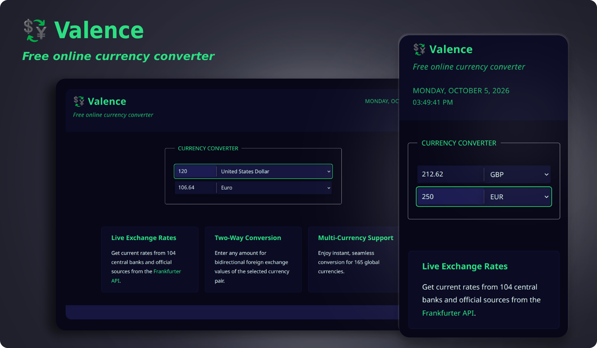
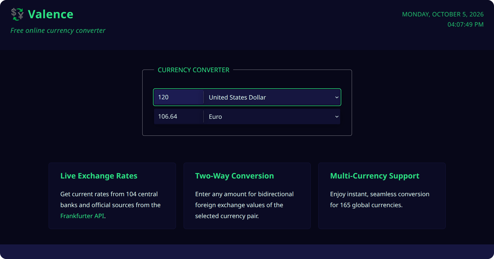
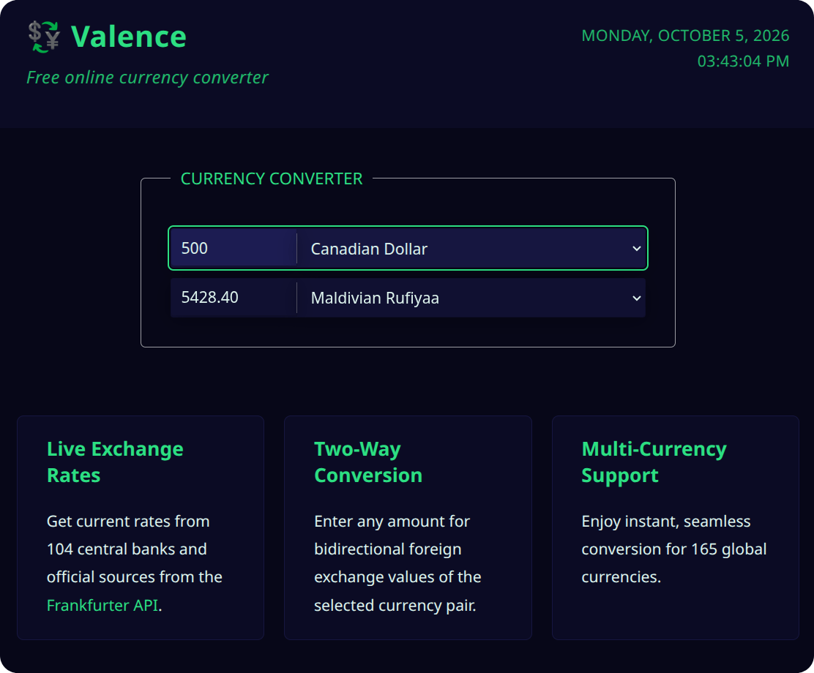
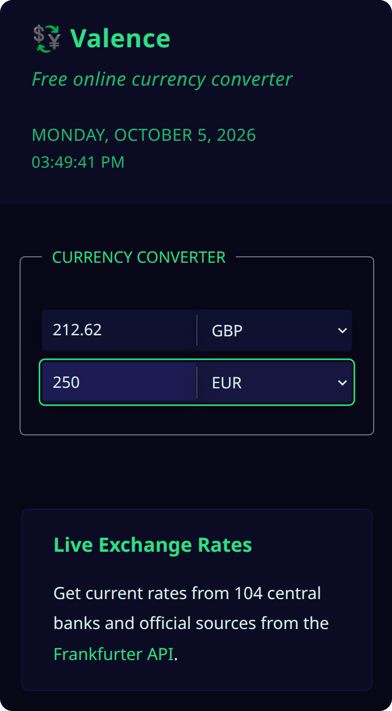

<div align='center'>

# 💱 Valence

**_— Free online currency converter —_**

A mobile-first, accessible currency converter built with React and JavaScript.  
Supports conversion across 165 currencies using live exchange rates and bidirectional conversion.



     

</div>

---

## ⫶☰ Table of Contents

- [Live Demo](#-live-demo)
- [Screenshots](#-screenshots)
- [Tech Stack](#-tech-stack)
- [Features](#-features)
- [Tech Highlights](#tech-highlights)
- [Installation and Development](#-installation-and-development)
- [Project Structure](#-project-structure)
- [License](#-license)

---

## 🌐 Live Demo

[](https://ana-vucic-dev.github.io/valence/)

---

## 📸 Screenshots

<details>
  <summary><strong>View Screenshots</strong></summary>

<br>

### Desktop



### Tablet



### Mobile



</details>

---

## 🧰 Tech Stack

### ⚛️ Front End

- React 19
- Vite 8
- JavaScript (ES Modules)
- Vanilla CSS
- ESLint + React Hooks rules
- GitHub Pages deployment

### ⚡ API

- [Frankfurter API](https://frankfurter.dev/) for currency data and live exchange rates

---

## ✨ Features

- **Real-time foreign exchange rates** from 104 central banks and official financial sources

- **Two-way conversion** for the selected currency pair, with a dynamic input field for each currency

- **Multi-currency support**, enabling bidirectional conversion for 165 global currencies

---

<a id="tech-highlights"></a>

## 🛠️ Tech Highlights

### ⚛️ React Architecture

- **Custom hooks** for reusability and separation of concerns

- **Reusable components** for feature cards, error messages, loading state, and drop-down lists

### 🤝 Accessibility (A11y)

- **Semantic markup** (fieldsets, legends, ARIA attributes)

- **Live region announcements** for screen-reader feedback

- **Color contrast** meeting WCAG AAA for normal text

### 📱 Responsive Design

- **Mobile-first UI** with touch-friendly controls

- **Adaptive layout** for tablet, desktop, and 4K screens

---

## 🚀 Installation and Development

> [!IMPORTANT]
> **Prerequisites:**
>
> - Node.js ≥ 20.19

### 🖥️ Local Setup

```bash
git clone https://github.com/ana-vucic-dev/valence.git
cd valence
npm install
npm run dev
```

### ⚙️ Production Build

```bash
npm run build
```

### 🔍 Build Preview

```bash
npm run preview
```

---

## 📂 Project Structure

```text
/
├── public/
│   ├── favicon/
│   └── screenshots/
├── src/
│   ├── components/     # Reusable UI components
│   ├── config/         # Static config (API URL, default currencies)
│   ├── data/           # Scalable feature content
│   ├── hooks/          # Custom hooks reused across UI logic
│   ├── utils/          # Pure helpers (formatting, calculations)
│   ├── index.css       # App-wide UI styling
│   ├── App.jsx         # App layout
│   └── main.jsx        # React entry point
├── index.html          # Vite entry file
├── .gitignore
├── package.json
├── package-lock.json
├── vite.config.js
├── eslint.config.js
├── README.md
└── LICENSE
```

---

## 📄 License

This project is licensed under the [MIT License](LICENSE).

---
